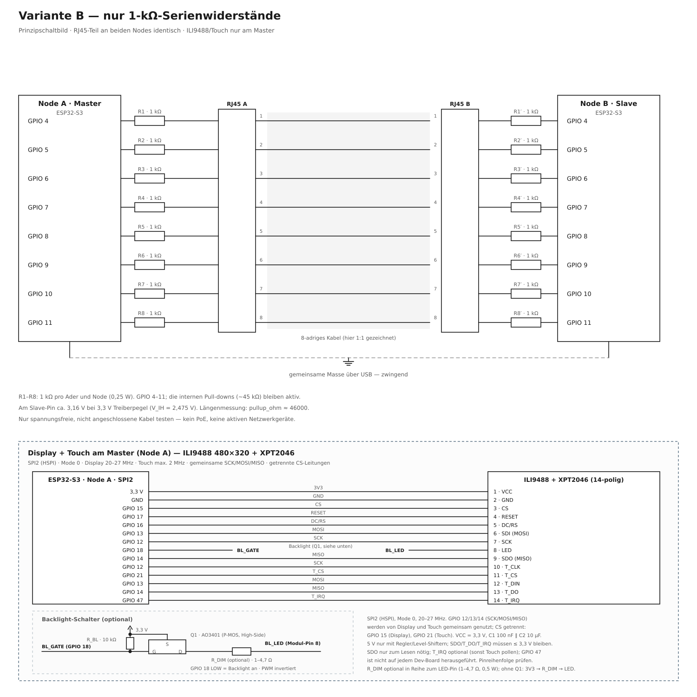
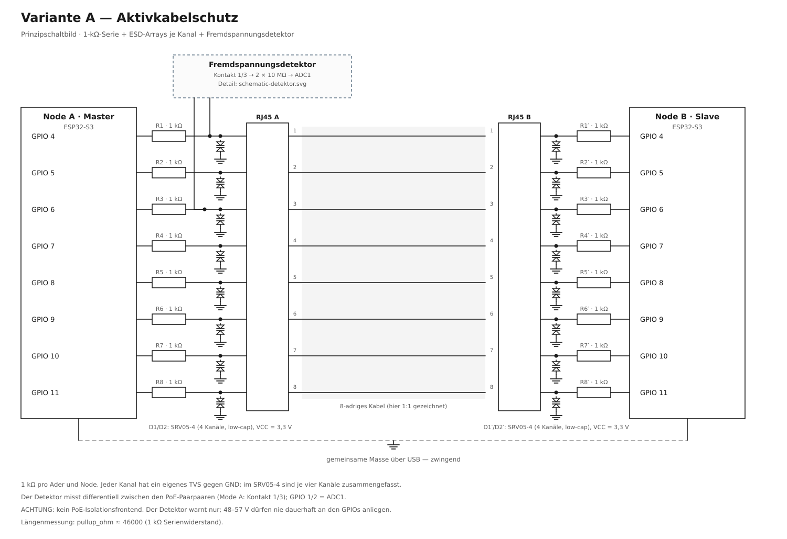
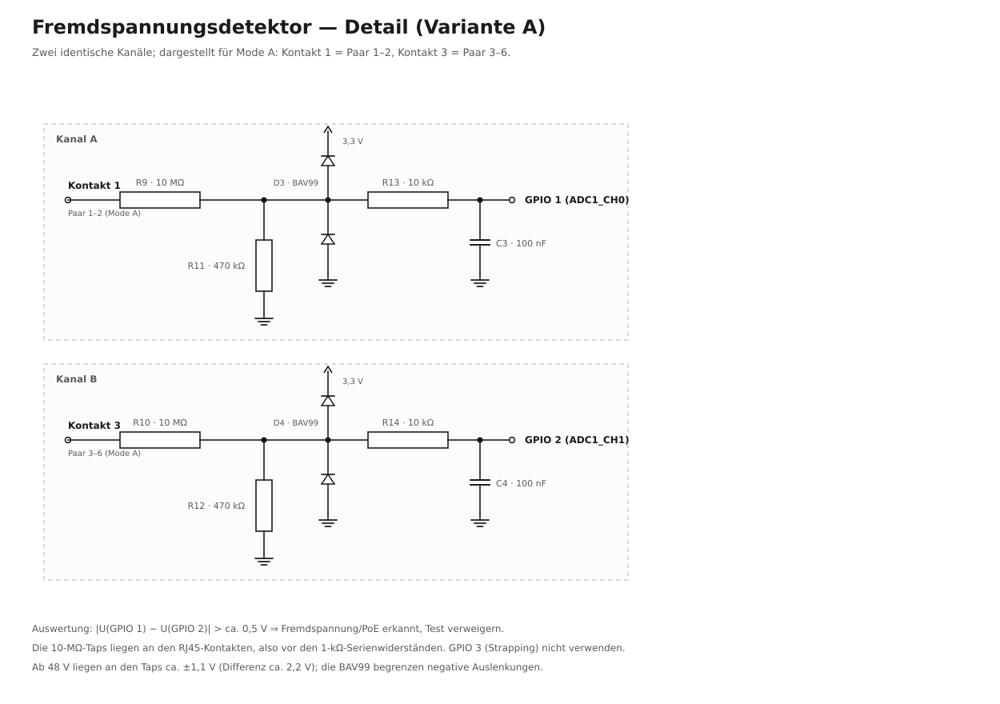

# RJ45-Netzwerkkabeltester auf ESP32

Zwei ESP32-Boards prüfen ein RJ45-Kabel an beiden Enden:

- **Node A = Master (ESP32-S3)**: spannt das WLAN für die Web-UI auf, steuert
  den Test und wertet beide Messseiten aus.
- **Node B = Slave (ESP32-S3)**: sitzt am gegenüberliegenden Kabelende, misst
  passiv die Pegel und antwortet über ESP-NOW.

Beide Nodes laufen auf ESP32-S3 und werden mit demselben Target `esp32s3`
gebaut; unterschieden werden sie nur durch die Rolle (Kconfig).

Die Funkstrecke zwischen den Boards ist **ESP-NOW** (WLAN-Funk ohne Router, ohne
IP/DHCP). Der Master läuft dafür im APSTA-Modus: Access Point für Handy/Laptop,
STA-Schnittstelle für ESP-NOW. Zusätzlich gibt es eine serielle Konsole.

## Wichtig: gemeinsame Masse

Beide Tester müssen dieselbe elektrische Masse haben, sonst kann der Slave die
vom Master getriebenen Pegel nicht sehen und meldet alle Adern als offen.

- Beide USB-Kabel am selben Rechner bzw. an einem aktiven USB-Hub betreiben,
  **oder** eine GND-Leitung zwischen den Boards vorsehen.
- Beide Boards vor dem Test mit Strom versorgen.
- Nur **spannungsfreie, nicht angeschlossene** Kabel testen. Die GPIOs arbeiten
  mit 3,3 V und sind nicht 5-V-tolerant; nicht an aktive Netzwerkgeräte oder
  PoE anschließen. Die Schutzvarianten im
  [Schaltplan](#schaltplan-und-schutzbeschaltung) ändern daran nichts
  Grundsätzliches: Sie begrenzen Ströme und erkennen Fremdspannung, sind aber
  kein PoE-Isolationsfrontend.
- Die RJ45-Buchsen müssen direkt (ohne PHY/Magnetics), höchstens über die
  Serienwiderstände aus dem Schaltplan, mit den GPIOs verbunden sein.

## Funktionen

- 8×8-Messmatrix: welche Ader an A mit welcher Ader an B verbunden ist
- Unterbrechungen und Kurzschlüsse (auch innerhalb eines Steckers)
- Kabeltyp-Erkennung: 1:1-Patchkabel, Crossover (Gigabit und 10/100),
  benutzerdefinierte Belegung, fehlerhaft
- Experimentelle Längenmessung pro Ader (Median, per-Ader-Kalibrierung im NVS)
- Fehlerortung bei offenen Adern: Bruchdistanz vom Master (ca. ±20–30 %)
- Wackeltest/Intermittenzerkennung: Test läuft mehrfach, pro Ader wird
  stabil/instabil gemeldet
- Grobe Kurzschlussklassifikation **hart/weich** über den ADC (experimentell)
- Suchton auf einer Ader für die Adernsuche mit einem Induktionspiepser
- Web-UI im WLAN mit Verdrahtungsgrafik, Matrix, Diagnose, Rohdaten,
  Wackeltest sowie Werkzeugen (Suchton, Längenkalibrierung)
- Grafisches Display am Master (LVGL, Porträt 320×480): Status, Testkarten
  für Verdrahtung, Matrix, Diagnose, Längen, Wackeltest und Werkzeuge
  (Suchton, Längenkalibrierung); Touch-Bedienung mit Vier-Punkt-Kalibrierung
- Serielle Konsole mit `test`, `soak`, `len`, `tone`, `status`, `wifi`,
  `touchcal`, `reboot`, `help`
- Automatisches Wieder-Pairing (Slave sendet alle 3 s ein HELLO)

## Pin-Mapping

Die Arrays sind pro Node getrennt anpassbar und werden über das Build-Target
ausgewählt:

| RJ45-Kontakt | Node A (ESP32-S3 Master) | Node B (ESP32-S3 Slave) |
| --- | --- | --- |
| 1 | GPIO 4 | GPIO 4 |
| 2 | GPIO 5 | GPIO 5 |
| 3 | GPIO 6 | GPIO 6 |
| 4 | GPIO 7 | GPIO 7 |
| 5 | GPIO 8 | GPIO 8 |
| 6 | GPIO 9 | GPIO 9 |
| 7 | GPIO 10 | GPIO 10 |
| 8 | GPIO 11 | GPIO 11 |

Beide Nodes verwenden dieselbe RJ45-Verdrahtung auf GPIO 4–11; die Rolle wird
nur über die Firmware gewählt. Damit sind identische Platinen und Kabelbäume
für Master und Slave möglich. Ein Display am Master nutzt davon getrennte,
reservierte Pins (siehe unten).

Die Kontaktzählung entspricht der üblichen RJ45-/T568-Zählung; bitte einmal mit
einem Durchgangsprüfer gegen die eigene Platine verifizieren. Wenn eine Platine
anders verdrahtet ist, muss der jeweilige Pin-Array in `pin_map.hpp`
(`kNodeAPins`/`kNodeBPins`) entsprechend angepasst werden — die Tabelle ist nur
der sichere Default.

Ändern: `components/rj45_port/include/rj45_port/pin_map.hpp` (`kNodeAPins` und
`kNodeBPins`). Danach die betroffene Rolle neu bauen und flashen. Für den S3
vermeiden: GPIO 0/3/45/46 (Strapping), 19/20 (USB), 26–37 (Flash/PSRAM),
39–42 (JTAG), 43/44 (UART0). Nur falls doch noch ein Classic-ESP32 als Node
verwendet wird: GPIO 0, 2, 5, 12, 15 (Strapping), 6–11 (Flash), 34–39 (nur
Eingang), 1 und 3 (UART0) vermeiden.

### SPI-Display und Touch am Master (Node A)

Ein ILI9488-Modul (3,5 Zoll, 480×320, 14-polig) hängt ausschließlich am
Master; der Slave bleibt unverändert. Display und XPT2046-Touch teilen sich
SPI2 (HSPI). Die GPIOs sind in `pin_map.hpp` reserviert; die Anzeige-Firmware
ist implementiert: eine LVGL-Oberfläche im Porträtmodus (siehe „Display am
Master“ unter Bedienung).

| Modul-Pin | Signal | ESP32-S3 | Funktion |
| --- | --- | --- | --- |
| 1 | VCC | 3V3 | 3,3 V; 5 V nur bei Modulen mit Regler/Level-Shiftern |
| 2 | GND | GND | gemeinsame Masse |
| 3 | CS | GPIO 15 | Display-Chip-Select |
| 4 | RESET | GPIO 17 | Display-Reset |
| 5 | DC/RS | GPIO 16 | Data/Command |
| 6 | SDI (MOSI) | GPIO 13 | SPI2 MOSI |
| 7 | SCK | GPIO 12 | SPI2 SCLK |
| 8 | LED | Q1 → 3V3 | Backlight, Gate an GPIO 18 (Ein/Aus, PWM möglich); optional R_DIM |
| 9 | SDO (MISO) | GPIO 14 | optional, nur zum Lesen; bei Touch-Problemen offen lassen |
| 10 | T_CLK | GPIO 12 | Touch teilt SCK |
| 11 | T_CS | GPIO 21 | Touch-Chip-Select |
| 12 | T_DIN | GPIO 13 | Touch teilt MOSI |
| 13 | T_DO | GPIO 14 | Touch-Datenausgang |
| 14 | T_IRQ | GPIO 47 | Touch-IRQ (optionaler Hinweis) |

Die Tabelle folgt der verbreiteten 14-poligen Modulbelegung; die
Beschriftung auf der eigenen Platine ist maßgeblich. Kapazitive
Touch-Varianten haben an Pin 10–14 andere Signale (C_SCL/C_SDA/C_INT) und
werden nicht unterstützt.

- **SPI:** Mode 0, 40 MHz und kurze Leitungen. Das liegt oberhalb der
  ILI9488-Spezifikation von 20 MHz; die meisten Module laufen stabil damit,
  bei Streifen/Artefakten in `ili9488.cpp` auf 27 oder 20 MHz reduzieren.
  Der XPT2046 wird mit 2 MHz am selben Bus gelesen.
- **Touch-Anbindung:** Display und XPT2046 hängen am gemeinsamen SPI2-Bus;
  `T_CS` (GPIO 21) verwaltet der SPI-Treiber, die Koordinaten kommen über
  X/Y-Konvertierungen (max. 2 MHz, Mode 0). `T_IRQ` (GPIO 47) dient als
  schneller Berührungs-Hinweis, ist aber nicht zwingend. Beim ersten Start
  kalibriert die Firmware die vier Eckpunkte und speichert die Werte im NVS.
- **Gemeinsamer Bus:** GPIO 12/13/14 werden von Display und Touch genutzt,
  nur CS ist getrennt (GPIO 15 bzw. 21). SDO (Display) und T_DO (Touch) dürfen
  beide auf GPIO 14 liegen, weil immer nur ein Chip selektiert ist. Für den
  Touch ist **T_DO (Pin 13) zwingend**; SDO (Pin 9) wird nur benötigt, wenn das
  Display gelesen werden soll. Bei einem Konflikt (Display-SDO treibt die
  Leitung auch bei inaktivem CS) **Pin 9 offen lassen** — das Display
  funktioniert ohne SDO.
- **5-V-Betrieb:** VCC = 5 V nur, wenn das Modul einen eigenen 3,3-V-Regler
  und Level-Shifter hat und die Logikpins nachweislich 3,3 V führen. Der
  ESP32-S3 ist **nicht 5-V-tolerant**; 5 V an SDO, T_DO oder T_IRQ können
  die GPIOs zerstören. Im Zweifel das Modul mit 3,3 V betreiben oder
  Level-Shifter (z. B. TXS0108E) für alle Logikleitungen vorsehen. Bei
  5 V VCC den Backlight-LED-Pin nicht über den 3,3-V-Q1 schalten: LED
  direkt an 5 V oder einen 5-V-tauglichen High-Side-Treiber verwenden.
- **Backlight:** Der LED-Pin wird über einen P-MOSFET (z. B. AO3401)
  high-side an 3,3 V geschaltet. Gate an GPIO 18, 10-kΩ-Pull-up
  Gate–Source; GPIO 18 LOW = an. PWM ist hardware-seitig möglich (Duty
  invertiert), die aktuelle Firmware schaltet nur ein/aus. Viele Module
  haben den LED-Vorwiderstand an Bord; sonst ca. 33 Ω in Reihe und den
  Strom messen. Ohne Dimmen kann LED direkt an 3,3 V. Bei 5-V-Modulversorgung
  LED entweder fest an 5 V oder einen passenden High-Side-Treiber ergänzen;
  der dargestellte Q1 ist für 3,3 V ausgelegt.
- **Feste Dimmung:** Statt Q1/PWM kann ein Serienwiderstand **R_DIM**
  (1–4,7 Ω, 0,5 W) zwischen 3V3 und LED-Pin liegen. Bei 3,3 V ist die
  Wirkung stark (LED-Flussspannung nahe der Rail), den Wert daher mit
  Potentiometer/Strommessung bestimmen. Q1 und R_BL entfallen dann,
  GPIO 18 bleibt frei.
- **Entkopplung:** 100 nF und 10 µF modulnah zwischen VCC und GND.
- **GPIO 47:** Nicht auf jedem Dev-Board herausgeführt. Dann T_IRQ offen
  lassen; der Touch funktioniert weiter über die Druckmessung. Alternativ
  `display::kTouchIrq` in `pin_map.hpp` auf einen freien GPIO legen.
- **MicroSD-Slot:** bleibt ungenutzt; dessen CS nicht anschließen.

Die Konstanten stehen in `pin_map.hpp` im Namensraum `display`; ein
`static_assert` verhindert, dass sie mit `kNodeAPins` kollidieren. Der
SPI-Bus läuft über die GPIO-Matrix — für ein ILI9488 ist das unkritisch.
Wenn das Display anders verdrahtet wird, nur die `display::…`-Konstanten
anpassen; die RJ45-Pins bleiben unverändert. Die komplette Verdrahtung
inklusive Backlight-Schalter zeigt der erweiterte Schaltplan unter
Variante B.

## Schaltplan und Schutzbeschaltung

Der RJ45-Teil beider Nodes ist elektrisch identisch; die Rolle steckt nur in
der Firmware. Das Display/Touch-Modul sitzt ausschließlich am Master (siehe
Variante B unten). Jede der acht RJ45-Adern führt über einen
**1-kΩ-Serienwiderstand** auf den GPIO (GPIO 4–11). Der Widerstand sitzt auf
der Platine zwischen RJ45-Kontakt und GPIO.

**Wirkung der 1-kΩ-Widerstände:**

- Ein Kurzschluss zwischen zwei Adern oder nach GND begrenzt den Treiberstrom
  auf ca. 3,3 mA — der GPIO bleibt auch im Fehlerfall innerhalb seiner
  Spezifikation.
- ESD- und Fremdspannungsströme werden begrenzt.
- Die digitalen Messungen bleiben unverändert: Der interne Pull-down des
  Empfängers (~45 kΩ) bildet mit den Serienwiderständen beider Seiten
  (2 × 1 kΩ) einen Teiler. Am Slave-Pin liegen im guten Fall noch ca. 3,16 V,
  klar über V<sub>IH</sub> = 0,75 × 3,3 V = 2,475 V.
- Die Längenmessung lädt über 45 kΩ + 1 kΩ, also ca. 2 % länger;
  `LengthConfig::pullup_ohm` kann auf `46000` gesetzt werden. Das liegt weit
  innerhalb der experimentellen Toleranz von ±20–30 %.
- Die Widerstände ersetzen **nicht** die gemeinsame Masse. Beide Boards
  weiterhin über denselben USB-Host/Hub oder eine GND-Leitung verbinden.

Die 1 kΩ sind bewusst klein gewählt: Mehr Serienwiderstand erhöht den Schutz,
senkt aber den Pegel am Slave. Mit 4,7 kΩ je Seite lägen noch ca. 2,73 V an
(besserer Kompromiss), mit 10 kΩ nur noch 2,28 V — unter
V<sub>IH</sub> = 2,475 V.

> Beide Varianten sind für **spannungsfreie, nicht angeschlossene** Kabel
> gedacht. Variante A erkennt Fremdspannung und schützt gegen
> ESD/Transienten, ist aber **kein PoE-Isolationsfrontend**. 48–57 V dürfen
> nie direkt an den GPIOs anliegen.

Versorgung: Beide Dev-Boards werden über USB mit 5 V versorgt; die 3,3-V-Rail
entsteht auf dem Board. Das Display zieht mit Backlight ca. 90–150 mA; bei
instabiler Anzeige einen aktiven USB-Hub oder eine separate 5-V-Versorgung
verwenden. Die USB-GNDs beider Nodes müssen verbunden sein (gleicher
Host/Hub oder eine GND-Leitung), sonst funktioniert die Pegelmessung nicht.
Die Schaltbilder sind Prinzipschaltbilder (SVG), keine Layoutvorlage. Beide
Schaltungen sind dokumentierte Entwürfe; auf echter Hardware ist noch keine
der beiden Varianten erprobt.

### Variante B — nur 1-kΩ-Serienwiderstände

Minimalaufbau für passive Kabel: pro Ader ein 1-kΩ-Widerstand je Node, sonst
keine Bauteile am RJ45-Kontakt. Am Master kommt das Display-/Touch-Modul mit
seinem Backlight-Schalter hinzu; der untere Abschnitt des Schaltbilds zeigt
diese Erweiterung.



| Bauteil | Typ/Wert | Anzahl (Paar) | Funktion |
| --- | --- | --- | --- |
| R1–R8 | 1 kΩ, 1 %, 0,25 W | 8 | Serienwiderstand je Ader (Node A) |
| R1′–R8′ | 1 kΩ, 1 %, 0,25 W | 8 | Serienwiderstand je Ader (Node B) |
| Display | ILI9488 480×320 + XPT2046 | 1 | Anzeige/Touch, nur Master |
| Q1 | AO3401 (P-MOSFET, SOT-23) | optional | Backlight-Schalter (PWM), nur Master |
| R_BL | 10 kΩ | optional | Gate-Pull-up für Q1, nur Master |
| R_DIM | 1–4,7 Ω, 0,5 W | optional | feste Dimmung statt PWM, nur Master |
| C1 | 100 nF | 1 | Entkopplung Display, nur Master |
| C2 | 10 µF | 1 | Entkopplung Display, nur Master |

- Bestückung: 8 × 1 kΩ pro Board; im Bild heißen die Slave-Widerstände zur
  Unterscheidung R1′–R8′.
- Schützt gegen Kurzschluss und begrenzt ESD; Fremdspannung wird nicht erkannt.
- Aktive Ethernet-Pegel (±2,5 V) werden nur über die internen ESD-Dioden
  abgeleitet — nicht für den Dauerbetrieb an aktiven Ports geeignet.

### Variante A — Aktivkabelschutz

„Aktivkabelschutz“ heißt hier: ESD-/Transientenschutz an den Kontakten plus
Erkennung einer Fremdspannung, damit der Test gar nicht erst startet. Es ist
kein Isolationsfrontend.

Zusätzlich zum 1-kΩ-Serienwiderstand:

- **D1/D2 (SRV05-4 oder TPD4E05U06, low-cap):** ESD-Array direkt an den
  RJ45-Kontakten, also vor dem 1-kΩ-Widerstand. Zwei ICs pro Board decken die
  acht Adern ab. Die Kapazität (ca. 0,5–3 pF) liegt innerhalb der
  Messstreuung der Kapazitäts-/Längenmessung.
- **Fremdspannungsdetektor** (auf beiden Boards bestückbar): hochohmiger
  **differentieller** Teiler von den PoE-Paarpaaren auf zwei ADC1-Eingänge.
  Der Master wertet seinen Detektor vor dem Test aus; der Slave kann seinen
  lokal auswerten. Für eine Warnung vom Slave an den Master wäre das
  ESP-NOW-Protokoll zu erweitern.
  - Mode A (Datenpaare, 802.3af/at/bt): Kontakt 1 (Paar 1–2) und Kontakt 3
    (Paar 3–6).
  - Mode B (Spare-Paare): Kontakt 4 (Paar 4–5) und Kontakt 7 (Paar 7–8) —
    dafür einen zweiten Detektor vorsehen oder den Teiler umverdrahten.
  - Die Differenzmessung ist wichtig: Eine Spannungsmessung gegen die lokale
    Masse würde bei einem schwebenden PoE-Netz nur den Common-Mode-Anteil
    sehen. Der Teiler bildet deshalb die Spannung **zwischen** den Paaren.
- Optional: selbstheilende PTC-Sicherung pro Ader (z. B. 20 mA Hold), um einen
  versehentlichen PoE-Kontakt strommäßig zu begrenzen. Auslösezeit und
  TVS-Belastung müssen getestet werden; kein Ersatz für ein
  Isolationsfrontend.



Der Detektor im Detail (beide Kanäle; die 10-MΩ-Taps sind hochohmig genug, um
die übrigen Messungen nicht zu stören):



**Was der Schutz leistet:**

| Fall | Variante B | Variante A |
| --- | --- | --- |
| Kurzschluss zwischen Adern | 3,3 mA, GPIO geschützt | 3,3 mA, GPIO geschützt |
| ESD beim Stecken/Anfassen | nur über 1 kΩ begrenzt | ESD-Array + 1 kΩ |
| Aktives Ethernet (±2,5 V) | grenzwertig, interne Dioden | geclampt, aber **nicht sicher erkannt** |
| PoE/passives PoE (≥ 24 V) | **nicht geschützt** | Detektor warnt, TVS/1 kΩ nur kurzzeitig belastbar — **nicht PoE-sicher** |
| Fehlende gemeinsame Masse | wird nicht erkannt | wird nicht erkannt |

**Bauteile Variante A (pro Board):**

| Bauteil | Typ/Wert | Anzahl | Funktion |
| --- | --- | --- | --- |
| R1–R8 | 1 kΩ, 1 %, 0,25 W | 8 | Serienwiderstand, Strombegrenzung |
| D1, D2 | SRV05-4 (SOT-23-6) oder TPD4E05U06 | 2 | 4-Kanal-ESD-Array, 5 V Standoff, low-cap |
| C1, C2 | 100 nF | 2 | Entkopplung des ESD-Arrays an 3,3 V |
| R9, R10 | 10 MΩ | 2 | hochohmiger Teiler (Fremdspannung) |
| R11, R12 | 470 kΩ | 2 | Teilerfuß |
| D3, D4 | BAV99 | 2 | ADC-Klemmung gegen GND/3,3 V |
| R13, R14 | 10 kΩ | 2 | ADC-Serienwiderstand |
| C3, C4 | 100 nF | 2 | ADC-Stützkapazität |
| optional | PTC 20 mA (Hold) | 8 | PoE-Fehlerstrom begrenzen (Test nötig) |

**Firmware-Stand:** Der Detektor ist im Schaltplan vorgesehen, aber noch nicht
implementiert. Sinnvoller Ablauf am Master: vor jedem Test alle Leitungen
hochohmig schalten, ca. 100 ms warten, beide ADC-Kanäle lesen, `|U_A − U_B|`
bilden und bei Überschreitung von ca. 0,5 V den Test mit Warnung in
Web-UI/Konsole verweigern. Die ADC-Pins (z. B. GPIO 1/2; GPIO 3 ist Strapping-Pin und bleibt
frei) als Konstanten in `pin_map.hpp` ergänzen. Vor dem Layout prüfen, ob
GPIO 1/2 auf der eigenen Platine frei sind.

## Bauen und flashen

Voraussetzung: **ESP-IDF 6.1.x** (getestet mit 6.1.1). Die Komponentenstruktur
von IDF 6 wird vorausgesetzt (`esp_driver_gpio`, kein gebündeltes cJSON).

Das Target steht pro Rolle in den Defaults: Master = `esp32s3`
(`sdkconfig.master.defaults`), Slave = `esp32s3` (`sdkconfig.slave.defaults`).
Die beiden Images unterscheiden sich nur durch die Rolle und sind **nicht**
austauschbar.

Auf diesem Rechner:

```sh
source /home/agerf/.espressif/tools/activate_idf_v6.1.1.sh
cd /home/agerf/develop/network_cable_tester
```

Bei anderer Installation die ESP-IDF-Umgebung wie üblich laden
(z. B. `. $HOME/esp/esp-idf/export.sh`).

Beide Rollen bauen (getrennte Build-Verzeichnisse, sdkconfigs und Targets):

```sh
scripts/idf_role.sh master build
scripts/idf_role.sh slave build
```

Der erste Master-Build lädt **LVGL 9.x** über den ESP-IDF Component Manager
(Internetverbindung nötig). `managed_components/` ist git-ignoriert, die
Version steht in `dependencies.lock`. Bei einem vorhandenen
`sdkconfig.master` die neuen LVGL-Optionen ggf. per `menuconfig` übernehmen
oder die Datei löschen und neu bauen.

Falls ein bestehendes Build-Verzeichnis noch auf ein anderes Target zeigt
(`build-slave/` war früher auf `esp32` konfiguriert):

```sh
scripts/idf_role.sh master set-target esp32s3
scripts/idf_role.sh slave  set-target esp32s3
```

Flashen — **Master-Image auf Node A (ESP32-S3), Slave-Image auf Node B (ESP32-S3)**:

```sh
scripts/idf_role.sh master flash -p /dev/ttyACM0
scripts/idf_role.sh slave  flash -p /dev/ttyACM1
```

Welcher Port zu welchem Board gehört, zeigt `ls -l /dev/serial/by-path/`; die
Portnamen (`ttyACM0` ↔ `ttyACM1`) können sich beim Neu-Enumerieren ändern.
Beide Boards erscheinen in dieser Konfiguration als CH343-USB-UART-Brücke
(`1a86:55d3`) unter `/dev/ttyACM*`.

Monitor:

```sh
scripts/idf_role.sh master monitor -p /dev/ttyACM0
scripts/idf_role.sh slave  monitor -p /dev/ttyACM1
```

Die Rolle wird zur Compile-Zeit über Kconfig gewählt
(`CONFIG_CABLE_TESTER_ROLE_MASTER`/`..._SLAVE`, siehe
`main/Kconfig.projbuild`). Beide Boards brauchen also unterschiedliche Images.
Nach Protokolländerungen immer beide Rollen neu bauen und flashen.

Generierte Dateien (`sdkconfig.master`, `sdkconfig.slave`, `build-master/`,
`build-slave/`) sind per `.gitignore` ausgeschlossen.

## VS Code

Die Workspace-Konfiguration liegt unter `.vscode/` und ist eingecheckt:

- **Extensions** (auf diesem Rechner bereits installiert):
  `espressif.esp-idf-extension` und `ms-vscode.cpptools`.
- **IntelliSense** nutzt die `compile_commands.json` aus den Build-Verzeichnissen.
  Drei Konfigurationen stehen bereit: `ESP32 Master`, `ESP32 Slave` und
  `Host Tests` (umschalten über die Statusleiste unten rechts oder
  `C/C++: Select a Configuration…`).
- **Terminal**: Das Profil `ESP-IDF` lädt die ESP-IDF-Umgebung automatisch;
  neue integrierte Terminals starten damit.
- **Tasks** (`Terminal → Run Task…`): Master/Slave bauen, flashen (fragt nach
  dem seriellen Port), Monitor und Host-Tests. `Ctrl+Shift+B` baut beide Rollen.
- Die Espressif-Erweiterung ist auf den **Master-Build** voreingestellt
  (`build-master`, `sdkconfig.master`). Für den Slave die Tasks verwenden. Fragt
  die Erweiterung nach einem Setup, die vorhandene Installation
  `~/.espressif/v6.1.1/esp-idf` auswählen.
- Nach dem ersten Öffnen ggf. das Fenster neu laden
  (`Developer: Reload Window`), damit die Extensions aktiv werden.
- Falls IntelliSense nach Änderungen hakt: einmal bauen (aktualisiert
  `compile_commands.json`) und `C/C++: Reset IntelliSense Database` ausführen.
- JTAG-Debugging ist nicht vorkonfiguriert.

Auf diesem Rechner liegt VS Code unter
`~/develop/vscode/VSCode-linux-x64/bin/code` (nicht im `PATH`). Öffnen mit:

```sh
~/develop/vscode/VSCode-linux-x64/bin/code ~/develop/network_cable_tester
```

## Bedienung

1. Beide Tester mit gemeinsamer Masse mit Strom versorgen.
2. Das zu prüfende Kabel zwischen die beiden RJ45-Buchsen stecken.
3. Beim ersten Start am Display die vier Kreuze antippen (Touch-Kalibrierung).
   Danach im Display **Kabel testen** oder **Wackeltest** antippen; die
   Ergebnisse erscheinen auf den Seiten **Ergebnis**, **Wackel**, **Tool**,
   **Kabel** und **Matrix** (unten umschaltbar, kein Scrollen nötig).
4. Alternativ mit dem WLAN **`CableTester`** verbinden (Passwort
   **`cabletest123`**), <http://192.168.4.1/> öffnen, oben muss „Slave
   verbunden“ stehen; dann **Kabel testen** drücken. Für intermittierende
   Fehler **Wackeltest** starten und dabei am Stecker/Kabel wackeln. Unter
   **Werkzeuge** stehen Suchton und Längenkalibrierung zur Verfügung.
5. Oder seriell mit 115200 8N1: `test` startet einen Test, `soak` wiederholt
   ihn für den Wackeltest, `len` kalibriert die Längenmessung, `tone` erzeugt
   einen Suchton, `status` zeigt den Link, `wifi` zeigt/ändert SSID/Passwort,
   `touchcal` löscht die Touch-Kalibrierung (danach `reboot`), `reboot` startet
   das Board neu, `help` listet die Kommandos.

Auf dem ESP32-S3 läuft die serielle Konsole standardmäßig über **UART0**
(UART-USB-Port des Dev-Boards). Für den **nativen USB-Port** des S3 in
`menuconfig` `CONFIG_ESP_CONSOLE_USB_SERIAL_JTAG=y` setzen (oder in
`sdkconfig.master` eintragen) und neu bauen; die Firmware unterstützt beide
Konsolentypen. Die Web-UI funktioniert unabhängig davon.

### Wackeltest, Fehlerortung, Kalibrierung und Suchton

**Wackeltest (Intermittenz):** In der Web-UI **Wackeltest** drücken, im
Display den Button **Wackeltest** (Ergebnis auf der Seite **Wackel**) verwenden
oder seriell `soak [laeufe 1-200] [pause_ms 0-5000]` ausführen (Default 30
Läufe, 300 ms Pause). Während des Laufs am Stecker/Kabel wackeln. Pro Ader
werden verbundene/offene/kurzgeschlossene Läufe und die Zielader gezählt;
„stabil“ heißt: in allen Läufen verbunden, nie offen oder kurzgeschlossen und
immer dieselbe Zielader. Das ESP-NOW-Protokoll bleibt unverändert. Die
schnellen Wackeltest-Läufe prüfen nur die digitale Verbindung; die teure
Längen-/ADC-Messung läuft einmal im abschließenden Detailtest.

**Fehlerortung:** Bei einer offenen Ader misst der Master die Kapazität bis
zum Bruch und zeigt „Bruch ca. X m“ (Entfernung vom Master, ±20–30 %). Ein
Bruch direkt am fernen Stecker liest sich wie die volle Kabellänge. Bei einem
komplett offenen Kabel (kein Kabel gesteckt) wird nicht gemessen;
kurzgeschlossene Adern haben keinen Längenwert.

**Längenkalibrierung:** Ein sauberes Referenzkabel bekannter Länge anstecken
(alle Adern durchgängig, keine Kurzschlüsse, keine Fremdspannung) und
kalibrieren:

- **Web-UI:** **Werkzeuge → Längenkalibrierung**, Referenzlänge eintragen und
  **Kalibrieren**; **Zurücksetzen** löscht die Faktoren.
- **Display:** Seite **Tool**, Referenzlänge mit `-`/`+` (0,5-m-Schritte)
  einstellen und **Kalibrieren**; **Reset** löscht die Faktoren. Die Skalen
  erscheinen als Min/Max.
- **Seriell:** `len cal <meter>`, `len status`, `len reset`.

Der Master berechnet pro Ader einen Faktor aus der aktuellen Messung und
speichert ihn im NVS (Namespace `len_cal`). Die Faktoren gelten auch für
Bruchdistanzen.

**Kurzschlussart:** Bei Kurzschlüssen misst der Master die Spannung an den
beteiligten, auf der Master-Seite durchgängigen Adern über den internen
Pull-up (andere Adern Pull-down, Slave hochohmig). Daraus ergibt sich eine
grobe Einordnung **hart** (< 1,9 V) oder **weich** (hochohmig). Wegen der
streuenden internen Pull-up/Pull-down-Widerstände ist das experimentell.
Ist die Gegenader auf der Master-Seite offen, fehlt der Strompfad; ein harter
Kurzschluss kann dann als weich erscheinen. Ader 8 (GPIO 11) nutzt ADC2 und
kann bei aktivem WLAN Zeitüberschreitungen liefern; dann bleibt die Qualität
„unbekannt“.

**Suchton:** Ein Rechteckton (Default 1 kHz) auf genau einer Ader, zum
Aufspüren mit einem Tonprüfer/Induktionspiepser:

- **Web-UI:** **Werkzeuge → Suchton**, Ader (1–8) und Frequenz (50–10000 Hz)
  wählen, **Ton einschalten**; derselbe Button schaltet wieder aus.
- **Display:** Seite **Tool → Ton**; Ader 1–8 auswählen, Frequenz mit `-`/`+`
  (500-Hz-Schritte, 500–10000 Hz) einstellen und **Ton einschalten** bzw.
  **Ton ausschalten**.
- **Seriell:** `tone <ader 1-8> [frequenz_hz 50-10000]`, `tone off`.

Nur an spannungsfreien Kabeln verwenden; ein neu gestarteter Test stoppt den
Ton automatisch.

### Display am Master (LVGL)

Das ILI9488 (Porträt 320×480) wird beim Boot initialisiert und zeigt eine
grafische Oberfläche mit LVGL, angelehnt an die Web-UI:

- **Kopfzeile:** „Kabeltester“, Node/SSID, Status-Chip (verbunden/getrennt/
  Test läuft), RSSI und AP-IP
- **Test-Seite:** Hinweis zum Testen, großer Button **„Kabel testen“** sowie
  die Buttons **„Wackeltest“** und **„Touch kalibrieren“**
- **Ergebnis-Seite:** Verdikt, Diagnose (Kurzschlüsse inkl. hart/weich,
  offene Adern, Fremdspannung) und Längen pro Ader inkl. Bruchdistanz
  (experimentell) – mit denselben Farben wie die Web-UI (grün = gut,
  gelb = Warnung, rot = Fehler)
- **Wackel-Seite:** Statistik des letzten Wackeltests pro Ader (stabil/
  instabil, verbundene/offene/kurzgeschlossene Läufe, Zielader); der Lauf
  läuft in einem eigenen Task, die Oberfläche bleibt bedienbar
- **Tool-Seite:** zwei Unteransichten **Ton** und **Kalibrierung**.
  Ton: Ader 1–8, Frequenz mit `-`/`+` (500-Hz-Schritte), Ein/Aus-Schalter.
  Kalibrierung: Referenzlänge mit `-`/`+`, **Kalibrieren**, **Reset**,
  Skalenübersicht
- **Kabel-Seite:** Verdrahtungsgrafik A→B
- **Matrix-Seite:** Messmatrix; über **„Rohdaten“** lassen sich die Rohwerte
  einblenden
- **Touch-Bedienung:** sechs große Tabs am unteren Rand (Test, Ergebnis,
  Wackel, Tool, Kabel, Matrix); die Seiten wechseln ohne Scrollen. Die
  Koordinaten werden über den XPT2046 gelesen.

**Erste Inbetriebnahme / Kalibrierung:** Beim ersten Start (oder nach
`touchcal`) erscheinen vier Kreuze. Jedes Kreuz antippen und wieder loslassen;
die Firmware berechnet daraus eine affine Touch-Abbildung und speichert sie im
NVS (`touch_cal`). Wird innerhalb von ca. 10 s kein Touch erkannt, verwendet
die Firmware eine Standardabbildung und zeigt trotzdem die UI. Die Rohwerte
stehen im Log (`Touch raw x=… y=… z=…`); damit lässt sich die Verkabelung
prüfen.

**Touch neu kalibrieren:** Seriell `touchcal` am Master, danach `reboot`.
Alternativ den Button **„Touch kalibrieren“** am Ende der Display-Seite nutzen.

**Anpassen** (`components/display_ui/src/ili9488.cpp`):

- Bild gedreht/gespiegelt: `kMadctl` ändern — `0x48` = Porträt/BGR/X
  gespiegelt (aktuell), `0x08` = Porträt/BGR, `0x88` = Porträt/BGR/Y
  gespiegelt, `0xC8` = Porträt/BGR 180°.
- Farben vertauscht: BGR-Bit entfernen (z. B. `0x40` statt `0x48`).
- Bild invertiert: `cmd(0x21)` (INVON) in `Ili9488::init()` ergänzen.
- Streifen/Artefakte: `kSpiClockHz` in `ili9488.cpp` von 40 MHz auf 27 oder
  20 MHz reduzieren und die Leitungen kurz halten.

Ohne angeschlossenes Display startet die Firmware normal weiter (die Anzeige
bleibt leer); Web-UI und Konsole bleiben unverändert.

**LVGL/Abhängigkeiten:** Die LVGL-Komponente wird beim ersten Build über den
ESP-IDF Component Manager geladen (`components/display_ui/idf_component.yml`).
`managed_components/` ist git-ignoriert, `dependencies.lock` hält die Version
fest. Für die Master-Rolle sind die LVGL-Optionen in
`sdkconfig.master.defaults` hinterlegt. Bei einem bereits vorhandenen
`sdkconfig.master` werden neue Kconfig-Werte nicht automatisch übernommen —
dann `sdkconfig.master` löschen (oder `menuconfig`) und neu bauen.

Die UI nutzt Montserrat 20/28 für Überschriften; sind diese Fonts im
vorhandenen sdkconfig nicht aktiviert, fällt sie automatisch auf Montserrat 14
zurück und baut trotzdem. Für die vorgesehene Darstellung
`CONFIG_LV_FONT_MONTSERRAT_20=y` und `CONFIG_LV_FONT_MONTSERRAT_28=y` setzen
(menuconfig oder `sdkconfig.master` löschen und neu bauen).

### WLAN-Zugangsdaten ändern

Die Defaults stehen in `main/app_config.hpp` (`CableTester`/`cabletest123`).
Über die serielle Konsole des Masters lassen sie sich ändern; die Werte werden
im NVS gespeichert und überleben einen Neustart:

```text
wifi [status]           SSID, Passwort, Quelle, AP-IP, Kanal, MACs, Clients anzeigen
wifi ssid "Werkstatt"   SSID setzen (1-32 Zeichen, Leerzeichen in "...")
wifi pass "geheim123"   Passwort setzen (8-63 druckbare Zeichen)
wifi reset              Defaults wiederherstellen
```

`touchcal` löscht die gespeicherte Touch-Kalibrierung; nach `reboot` erscheint
beim nächsten Start wieder die Vier-Punkt-Kalibrierung auf dem Display.

`wifi` ohne Argument entspricht `wifi status` und zeigt zusätzlich die
AP-IPv4-Adresse samt Netzmaske/Gateway, den Kanal, die AP-/STA-MAC sowie alle
verbundenen WLAN-Clients mit ihrer per DHCP/ARP zugewiesenen IPv4-Adresse.

Die Änderung wird sofort angewendet; der AP startet dabei neu, verbundene
WLAN-Clients müssen sich also neu verbinden. Ohne gespeicherte Werte gelten die
Defaults. Bei vergessenem Passwort hilft `wifi reset` über die serielle
Konsole. Mit `reboot` startet das Board neu (auf Master und Slave verfügbar).

Der WLAN-Kanal ist fest **1** (`protocol::kChannel`); Master und Slave müssen
denselben Kanal verwenden.

Die Web-UI hat außer dem WPA2-Passwort keine weitere Authentifizierung — für den
lokalen Werkstattbetrieb gedacht.

## Messprinzip

Im Ruhezustand sind alle acht Leitungen Eingänge mit internem Pulldown. Ein
HIGH-Pegel ohne Ansteuerung wird als Warnung gemeldet (Fremdspannung/Defekt).

Für jede der acht Adern:

1. Der Master treibt genau diese Ader push-pull auf HIGH, alle anderen bleiben
   Eingänge mit Pulldown.
2. Nach 2 ms Settle-Zeit liest der Master seine acht Pegel und der Slave seine
   acht Pegel; der Slave schickt sein Bitmuster per ESP-NOW zurück.
3. Aus beiden Bitmustern entsteht die 8×8-Matrix.

Auswertung:

- Genau ein HIGH-Pegel am Slave → eindeutige Verbindung A<i> → B<j>.
- Mehrere HIGH-Pegel am Slave oder ein zusätzlicher HIGH-Pegel auf der
  Master-Seite → Kurzschluss.
- Kein HIGH-Pegel am Slave → Ader offen.
- Ein reiner Aderntausch ist **kein** Kurzschluss und wird als benutzerdefinierte
  Belegung erkannt.
- 1:1-Belegung → Patchkabel; vollständiger bzw. 10/100-Paartausch → Crossover;
  alles andere → benutzerdefiniert; Lücken/Mehrfachverbindungen → fehlerhaft.

### Kurzschlussgüte und Fehlerortung

Bei erkannten Kurzschlüssen misst der Master zusätzlich die Spannung an den
beteiligten Adern, sofern sie auf der Master-Seite durchgängig sind: Die Ader
wird über den internen Pull-up gehalten, alle anderen Adern liegen auf
Pull-down, der Slave geht hochohmig. Ein harter Kurzschluss bildet mit dem
Pull-down einen Spannungsteiler (ca. 1,6 V bei 3,3 V), ein hochohmiger
Feuchte-/Korrosionsübergang liegt darüber. Die Spannung wird per ADC gelesen
und als **hart** bzw. **weich** eingeordnet; Ader 8 läuft über ADC2 und kann
bei aktiver WLAN-Verbindung ausfallen.

Bei offenen Adern nutzt der Test dieselbe Kapazitätsmessung wie die
Längenmessung: Die Kapazität der noch angeschlossenen Aderstrecke ist
proportional zur Entfernung bis zum Bruch. Daraus entsteht „Bruch ca. X m“
vom Master. Das Verfahren ist grob (±20–30 %) und funktioniert nur, wenn der
Bruch zwischen den Steckern liegt; ein offener Kontakt direkt am fernen
Stecker liest sich wie die volle Länge.

### Längenmessung (experimentell)

Der Slave geht hochohmig, der Master lädt jede Ader ohne Kurzschluss über den
internen Pull-up auf und misst die Ladezeit; pro Ader werden fünf
Einzelmessungen gemacht und der Median verwendet. Aus `t = R·C·ln(4)` wird
die Kapazität und daraus mit ca. 50 pF/m eine Länge geschätzt. Die interne
Pull-up-Resistenz streut stark; die Werte sind nur grobe Anhaltspunkte
(±20–30 %). Kalibrierkonstanten stehen in `LengthConfig` in
`components/rj45_port/include/rj45_port/rj45_port.hpp`.

Die Messung läuft auch bei einzelnen offenen Adern (als Bruchdistanz).
Komplett offene Kabel werden übersprungen, kurzgeschlossene Adern erhalten
keinen Längenwert. Über `len cal <meter>` (Konsole),
**Werkzeuge → Längenkalibrierung** (Web-UI) bzw. **Tool → Kalibrieren**
(Display) lässt sich pro Ader ein Kalibrierfaktor aus einem Referenzkabel im
NVS (`len_cal`) speichern; die Ausgabe erfolgt in Konsole und Web-UI pro Ader.

Mit den 1-kΩ-Serienwiderständen aus dem Schaltplan steigt die effektive
Ladezeit um ca. 2 % (`pullup_ohm` dann auf `46000` setzen). Die low-cap
ESD-Arrays der Schutzvariante liegen mit ca. 0,5–3 pF innerhalb der
Messstreuung.

### Grenzen

- **T568A und T568B sind elektrisch identisch** (gleiche Paar-Pin-Zuordnung).
  Ein Kontinuitätstester kann sie nicht unterscheiden. Erkannt werden 1:1,
  Crossover, offene Adern, Kurzschlüsse und abweichende Belegungen.
- Kurzschlüsse können eine offene Ader überdecken; bei mehreren Fehlern ist die
  Topologie nicht immer eindeutig. Die Rohmatrix zeigt alle Beobachtungen.
- Die internen Pull-downs sind schwach; sehr lange oder hochohmige Kabel können
  als offen erscheinen.
- **Kurzschlussgüte:** nur eine grobe Einordnung; die internen Pull-up-/
  Pull-down-Widerstände streuen stark, Ader 8 (ADC2) kann bei WLAN
  Zeitüberschreitungen liefern. Ist die Gegenader auf der Master-Seite offen,
  fehlt der Strompfad und ein harter Kurzschluss kann als weich erscheinen.
  Kein Ersatz für eine Isolationsmessung mit definierter Prüfspannung.
- **Bruchdistanz:** ±20–30 %, nur bei offenen Adern und nur mit einem
  definierten Strompfad; bei mehreren Fehlern oder einem Bruch direkt am
  fernen Stecker ist die Ortsangabe ungenau.
- **Wackeltest:** erkennt Änderungen zwischen den digitalen Testläufen; sehr
  kurze Aussetzer zwischen zwei Läufen können unentdeckt bleiben.

## Projektstruktur

```
components/
  cable_test/    reine C++-Analyse-Logik (ohne ESP-IDF, host-testbar)
  rj45_port/     GPIO-Schicht + Pin-Mapping pro Node
  cable_link/    ESP-NOW-Protokoll, Master-/Slave-Link
  test_runner/   Ablaufsteuerung der Messung
  length_cal/    per-Ader-Längenkalibrierung im NVS + Kalibrierablauf
  report/        JSON- und Text-Report
  web_ui/        HTTP-Server + eingebettete Single-Page-UI
  display_ui/    LVGL-Oberfläche + ILI9488/XPT2046-Treiber (nur Master)
main/            Rollenwahl, WLAN-AP/STA, Konsole, app_main
host_tests/      Host-Tests für die Analyse
scripts/         idf_role.sh (Build/Flash pro Rolle)
.vscode/         VS-Code-Workspace (IntelliSense, Tasks, Extension-Empfehlungen)
docs/            SVG-Schaltbilder für das README
```

Datenfluss Master: Display/Web-UI/Konsole → `TestRunner` → `Rj45Port`
(treiben/lesen) + `MasterLink` (Slave-Abfrage) → `cable_test::analyze` →
`report` → Display/HTTP/Seriell.

## Tests

```sh
cmake -S host_tests -B host_tests/build
cmake --build host_tests/build
ctest --test-dir host_tests/build --output-on-failure
```

Die Host-Tests decken ab: 1:1, Crossover (Gigabit und 10/100), offene Ader,
Kurzschluss am fernen und nahen Ende, Tausch vs. Kurzschluss, doppelte
Zuordnung, Ruhezustand mit Fremdspannung, komplett offenes Kabel,
Bruchdistanz aus der Längenmessung, Kurzschlussgüte hart/weich sowie die
Wackeltest-Statistik (stabil, offene Ader, Wechsel der Zielader).

Zusätzlich müssen beide Firmware-Rollen fehlerfrei bauen:

```sh
scripts/idf_role.sh master build
scripts/idf_role.sh slave build
```

## Fehlersuche

| Symptom | Ursache/Abhilfe |
| --- | --- |
| Alle 8 Adern offen | Kabel nicht gesteckt, **fehlende gemeinsame Masse**, falsches Pin-Mapping |
| „Slave getrennt“ | Slave ohne Strom, anderer Kanal, unterschiedliche Firmware; nach 3 s sendet der Slave erneut ein HELLO |
| Web-UI nicht erreichbar | Mit der aktuellen SSID verbunden? Master-Logs prüfen, <http://192.168.4.1/>; bei vergessenem Passwort seriell `wifi reset` |
| SSID/Passwort vergessen | Seriell am Master `wifi reset` (stellt die Defaults aus `app_config.hpp` wieder her) |
| Test bricht mit Verbindungsfehler ab | Funkstrecke/Power des Slaves prüfen; Master und Slave neu starten |
| Serielle Ausgabe unlesbar | 115200 8N1 einstellen |
| Monitor: `-- WARNING: Writing to serial is timing out …` | Der Host kann nicht in den Port schreiben; meist hängt die USB-UART-Brücke (z. B. CH343), oder es ist der falsche Port. USB-Kabel abziehen/neu anstecken, anderen Port/Kabel testen, `journalctl -k -f` prüfen. Die REPL läuft auf UART0 (UART-USB-Port), nicht auf dem nativen USB-Port. |
| Monitor: „device reports readiness … multiple access on port“ / Port verschwindet | USB-Kabel/-Port/Stromversorgung prüfen. Das Kernel-Log (`journalctl -k -f`) zeigt dann `USB disconnect`, `error -71` und Neu-Erkennung. Laufenden Monitor beenden und den stabilen Pfad `/dev/serial/by-path/…` verwenden. Der Portname (`ttyACM0` ↔ `ttyACM1`) kann sich beim Neu-Enumerieren ändern; `idf.py monitor` folgt ihm nicht. |
| S3: keine Logs/Konsole über den nativen USB-Port | Die Konsole läuft per Default über UART0. Für USB Serial/JTAG `CONFIG_ESP_CONSOLE_USB_SERIAL_JTAG=y` setzen und neu bauen; die Web-UI ist davon unabhängig. |
| `phy_init: failed to load RF calibration data` | Normal beim ersten Boot nach dem Flashen (vollständige RF-Kalibrierung). Erst kritisch, wenn das Board dabei resetet oder der USB-Port verschwindet – dann Stromversorgung/Cable prüfen. |
| Display bleibt dunkel/weiß | Backlight prüfen (Q1-Gate an GPIO 18, LOW = an; ohne Q1 LED direkt an 3V3), 3,3-V-Versorgung und SPI-Leitungen 12–17 kontrollieren. Im Log erscheint `ILI9488 initialisiert …` bzw. ein Fehler. |
| Display-Bild gedreht, gespiegelt oder Farben vertauscht | `kMadctl` in `components/display_ui/src/ili9488.cpp` anpassen (`0x48` Porträt/BGR/X gespiegelt, `0x08` Porträt/BGR, `0x88` Y gespiegelt, `0xC8` 180°). |
| Display zeigt Streifen/Artefakte | SPI-Takt (`kSpiClockHz` in `ili9488.cpp`) von 40 MHz auf 27 oder 20 MHz reduzieren und Leitungen kurz halten. |
| Touch trifft daneben oder startet nichts | Vier-Punkt-Kalibrierung erneut ausführen (Button „Touch kalibrieren“ oder seriell `touchcal` + `reboot`). T_CLK/T_CS/T_DIN/T_DO müssen wie im Schaltplan verdrahtet sein; `T_IRQ` ist optional. Die Rohwerte stehen im Log (`Touch raw x=…`). |
| Touch-Kalibrierung hängt/keine Berührung erkannt | Prüfen, ob der XPT2046 überhaupt am SPI-Bus antwortet (T_CS/T_CLK/T_DIN/T_DO, 3,3 V). Nach ca. 10 s fällt die Firmware auf die Standardabbildung zurück; die Anzeige bleibt nutzbar. |
| Log zeigt `raw x=0 y=0` bzw. `z1=0 z2=0` | Der XPT2046 liefert keine SPI-Daten. **T_CS (GPIO 21)** und **T_DO (GPIO 14)** prüfen; **Pin 9 (Display-SDO) testweise von GPIO 14 abklemmen**, nur Pin 13 (T_DO) anschließen. T_CLK muss an GPIO 12, T_DIN an GPIO 13. Die Modul-Pinreihenfolge kann abweichen — Beschriftung kontrollieren. Nur `T_IRQ` reicht nicht. |
| Build-Fehler `cjson`/`driver/gpio.h` | ESP-IDF 6.1.x verwenden (dieses Projekt nutzt `esp_driver_gpio` und kein cJSON) |

## Status

Build beider Rollen (Master und Slave, jeweils `esp32s3`) mit ESP-IDF 6.1.1 und
die Host-Tests sind verifiziert. Die Inbetriebnahme auf echter Hardware (beide
Boards, reales Kabel) steht noch aus. Das Master-Display nutzt jetzt LVGL im
Porträtmodus (320×480) mit einer Web-UI-ähnlichen Kartenoberfläche und
Vier-Punkt-Touch-Kalibrierung; die Inbetriebnahme auf echter Display-Hardware
steht ebenfalls noch aus. Wackeltest, Fehlerortung, Längenkalibrierung,
Kurzschlussgüte und Suchton sind implementiert und bauen, wurden aber noch
nicht an realen Kabeln verifiziert — insbesondere die ADC-Kurzschlussgüte und
die per-Ader-Kalibrierung brauchen Messungen an Referenzkabeln.
